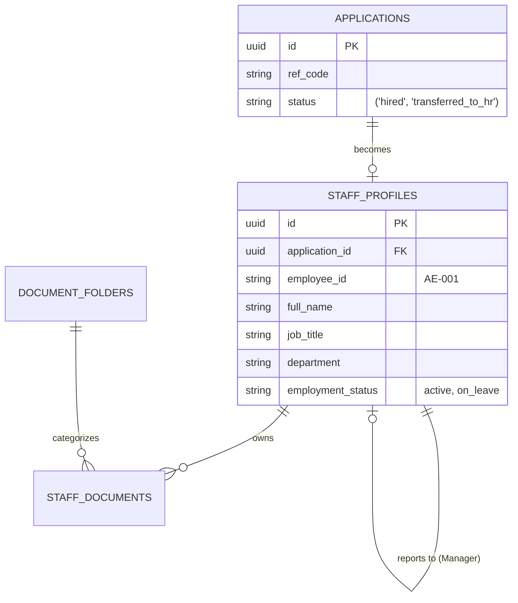

# Aerojet HRIS: Future Implementation Roadmap

This document outlines the strategic plan to evolve the existing Aerojet Careers portal into a fully-fledged, internally-owned **Human Resources Information System (HRIS)**. By leveraging the existing "Shared Brain" architecture (Supabase), we can create a seamless transition from applicant to employee without third-party dependencies.

---

## 🏗️ The "Shared Brain" Architecture

Rather than creating separate silos, the **Aerojet Enterprise Suite** will use a unified database. This ensures that a single record of truth follows a person from the moment they apply to the day they retire.

### Database Relationship Visualization

Currently, we have two primary tables. Here is how they connect in the "Shared Brain" model:

---

## 📅 Phased Implementation Plan

### Phase 1: The Core (Current Status)
*   **Automated Handoff**: When an application status flips to `hired`, a basic `staff_profile` is generated.
*   **Document Management**: Basic folder structure (Personal, Qualifications, Contracts) already implemented.
*   **Identity**: Employees can log in to view their own profile.

### Phase 2: Organizational Intelligence (Next 3-6 Months)
*   **Reporting Hierarchy**: Implement the `reporting_manager_id` link to create a visual "Org Chart."
*   **Time Off & Leave**:
    *   [NEW] `leave_requests` table: Tracking vacation, sick leave, and technical training downtime.
    *   [NEW] `leave_balances` table: Automated calculation of yearly leave days.
*   **Internal Directory**: A high-end UI for staff to find colleagues across Aerojet bases (Accra, etc.).

### Phase 3: Financial & Operational (Next 6-12 Months)
*   **Payroll Hub**: 
    *   Secure storage of bank details and tax IDs.
    *   Integration with local banking APIs for automated salary disbursement.
*   **Asset Tracking**: 
    *   Tracking company equipment (Laptops, Uniforms, Specialized Tools) assigned to staff.
*   **Performance Reviews**:
    *   Quarterly feedback cycles and KPI tracking directly linked to the employee's `job_title`.

---

## 🔒 Security & Data Integrity

> [!IMPORTANT]
> **No more external API Keys!** 
> Since both systems will reside in the same Supabase project, you no longer need complex "Consumer" API keys. Instead, we use **PostgreSQL Row-Level Security (RLS)**.

### Access Control Strategy:
1.  **Recruiters**: Can see `applications` but NOT `payroll` or `leave_balances`.
2.  **HR Managers**: Full access to all `staff_profiles` and internal data.
3.  **Employees**: Can see their *own* `staff_profile` and `leave_requests`, but cannot see others'.
4.  **Security Token**: For specific integrations (like a separate Aerojet App), we will use an **Internal Service Key** that never leaves the Aerojet network.

---

## 🚀 Next Steps for Implementation

1.  **Infrastructure Audit**: Ensure the Supabase `staff_profiles` table is expanded with necessary fields (Home Address, Emergency Contact).
2.  **UI Design**: Begin prototyping the "Employee Self-Service" dashboard (similar to the Admin Dashboard but for staff).
3.  **Migration Script**: Finalize a script that automatically populates the `reporting_manager_id` based on your current organizational chart.

---
*Created for Aerojet Aviation Group — Strategic Implementation Document v1.0*
